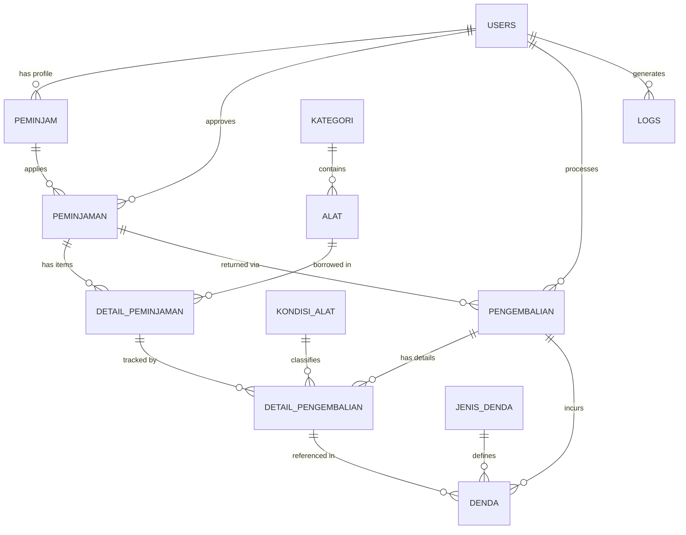

# SIPERALAT - Sistem Informasi Peminjaman & Pengembalian Alat Inventaris

[](https://laravel.com)
[](https://php.net)
[](https://tailwindcss.com)
[](https://mysql.com)
[](https://phpunit.de)

Aplikasi web terintegrasi untuk pengelolaan peminjaman, serah terima, inspeksi fisik kondisi barang, kalkulasi denda, serta pencatatan pengembalian alat inventaris (laboratorium dan peralatan *outdoor/camping*). Dibangun dengan fokus pada **alur bisnis peminjaman yang realistis**, **transisi status satu-klik tanpa hambatan**, **perhitungan otomatis denda keterlambatan dan kerusakan**, serta **penerbitan struk & nota resmi**.

Live Demo: [https://siperalat.uroo.my.id](https://siperalat.uroo.my.id)  
Repository: [https://github.com/uroo-dev/siperalat](https://github.com/uroo-dev/siperalat)

---

## Daftar Isi
- [Gambaran Umum](#gambaran-umum)
- [Akun Demo](#akun-demo)
- [Fitur Utama](#fitur-utama)
- [Keunggulan Arsitektur & Rekayasa Teknis](#keunggulan-arsitektur--rekayasa-teknis)
- [Tech Stack](#tech-stack)
- [Struktur Database & Relasi](#struktur-database--relasi)
- [Instalasi Lokal](#instalasi-lokal)
- [Pengujian Otomatis (Testing)](#pengujian-otomatis-testing)
- [Struktur Direktori](#struktur-direktori)
- [Batasan & Rencana Pengembangan](#batasan--rencana-pengembangan)
- [Tentang Pengembang](#tentang-pengembang)

---

## Gambaran Umum

**SIPERALAT** mendigitalkan seluruh ekosistem peminjaman dan penyewaan alat inventaris dari hulu ke hilir. 

Pengunjung dapat menjelajahi katalog ketersediaan alat secara publik, melihat stok aktual dan spesifikasi alat, serta mengajukan pemesanan pinjam secara mandiri. Dari sisi operasional, administrator dan petugas dapat menyetujui peminjaman dalam satu klik, menyerahkan alat fisik, melakukan pemeriksaan fisik (*quality check*) saat pengembalian, mengenakan denda keterlambatan atau kerusakan jika ada, serta mencetak struk pengembalian dan nota bukti transaksi resmi.

---

## Akun Demo

| Peran (Role) | Username | Email | Password | Hak Akses Utama |
|---|---|---|---|---|
| **Super Admin** | `uroo` | `uroo@gmail.com` | `password` | Akses penuh dashboard, transaksi peminjaman & pengembalian, manajemen alat & kategori, manajemen pengguna, laporan rekapitulasi, dan audit log |
| **Petugas** | `petugas` | `petugas@gmail.com` | `password` | Pengelolaan data peminjaman, serah terima alat, inspeksi pengembalian & denda, inventaris alat, serta pencetakan struk dan laporan |
| **Peminjam 1** | `peminjam` | `peminjam@gmail.com` | `password` | Eksplorasi katalog publik, reservasi peminjaman alat online, riwayat pengajuan |
| **Peminjam 2** | `dimas` | `dimas@gmail.com` | `password` | Peminjaman alat outdoor, pengecekan nota dan status berjalan |

> **Catatan**: Data akun demo di atas diinisialisasi secara otomatis melalui database seeder (`DatabaseSeeder.php`). Jangan gunakan kredensial demo ini di lingkungan *production*.

---

## Fitur Utama

### 🏕️ Peminjam & Publik
- **Katalog Alat Inventaris Publik**: Menjelajahi katalog alat lengkap dengan foto resolusi tinggi, ketersediaan stok aktual, tarif sewa per hari, dan spesifikasi teknis.
- **Pengajuan Peminjaman Mandiri**: Formulir reservasi cepat yang terintegrasi dengan penghitungan estimasi biaya sewa berdasarkan durasi hari peminjaman.
- **Penerbitan Kode Tiket Transaksi**: Menghasilkan kode tiket unik `TRX-XXXXXX` sebagai bukti validasi saat mengambil alat di pos operasional.
- **Nota Bukti Peminjaman**: Akses cetak lembar nota peminjaman yang memuat jadwal pinjam, tenggat pengembalian, dan rincian peralatan.

### 🛡️ Administrator & Petugas
- **Dashboard Ringkasan Operasional**: Statistik total inventaris alat, transaksi aktif berjalan, unit yang sedang dipinjam, unit rusak, serta log aktivitas sistem terkini.
- **Alur Status Peminjaman Instan (One-Click Action)**:
  - **Tahap 1 (`Menunggu Konfirmasi`)**: Verifikasi cepat pengajuan. Tombol *Setujui* langsung mengonversi transaksi ke status disetujui, atau tombol *Tolak* dengan input alasan penolakan.
  - **Tahap 2 (`Disetujui / Siap Ambil`)**: Tombol *Serahkan Alat* satu-klik untuk serah terima barang fisik ke peminjam, otomatis memotong stok tersedia dan menambah stok dipinjam.
  - **Tahap 3 (`Sedang Dipinjam` / `Sebagian Dikembalikan`)**: Tombol *Pengembalian* langsung memicu modal inspeksi fisik dan denda.
  - **Tahap 4 (`Selesai Dikembalikan`)**: Transaksi final selesai dengan akses langsung cetak struk pengembalian.
- **Inspeksi Fisik & Perhitungan Denda Realistis**:
  - Pengecekan unit alat per baris: input jumlah kembali dan penetapan kondisi fisik (*Baik*, *Rusak Ringan*, *Rusak Berat*).
  - Pemulihan stok cerdas: unit *Baik* kembali ke stok siap pakai (`stok_tersedia`), sedangkan unit cacat/rusak otomatis dipindahkan ke `stok_rusak`.
  - Deteksi keterlambatan otomatis: menghitung selisih hari pengembalian dari batas rencana dan mengkalkulasi estimasi denda per hari keterlambatan.
  - Input denda kerusakan/perbaikan jika alat dikembalikan dalam kondisi cacat fisik.
  - Akumulasi live total tagihan akhir (`Tagihan = Subtotal Sewa + Total Denda`).
- **Struk Pengembalian & Dokumen Siap Cetak**:
  - Halaman struk digital resmi siap cetak berformat standar slip pengembalian inventaris.
  - Lengkap dengan rincian hasil cek fisik alat, breakdown denda keterlambatan/kerusakan, dan kolom tanda tangan kedua belah pihak.
- **Manajemen Inventaris Alat & Kategori**: CRUD alat inventaris lengkap dengan upload foto, penentuan tarif sewa, stok total, stok rusak, dan nilai penggantian unit.
- **Laporan Rekapitulasi & Log Audit**: Rekapitulasi transaksi berdasarkan rentang tanggal dan status dengan fitur cetak laporan berformat tabel bersih.

---

## Keunggulan Arsitektur & Rekayasa Teknis

1. **Integritas Inventaris Stok Multi-Kondisi**:
   - Stok terkelola secara ketat dalam 3 state dinamis: `stok_tersedia`, `stok_dipinjam`, dan `stok_rusak`. Setiap perubahan status peminjaman dan kondisi pengembalian secara atomik memperbarui stok guna mencegah *over-lending* atau *phantom stock*.
2. **Eliminasi N+1 Query dengan Eager Loading**:
   - Seluruh pemanggilan relasi dioptimalkan menggunakan *Eager Loading* (`with(['peminjam.user', 'detailPeminjaman.alat', 'pengembalian.denda', 'disetujuiOleh'])`) guna menjamin efisiensi eksekusi database.
3. **Pencatatan Denda Transparan & Finansial Akurat**:
   - Setiap denda (keterlambatan maupun kerusakan) dicatat sebagai record tersendiri pada tabel `denda` berelasi dengan master `jenis_denda`, serta terakumulasi pada kolom `total_denda` dan `total_tagihan` transaksi.
4. **Keamanan Otorisasi Berbasis Middleware & Hashing**:
   - Proteksi route panel admin menggunakan custom middleware `RoleAdminPetugas` (`role.admin`), memastikan peminjam biasa tidak dapat memanipulasi stok, mengubah status, atau menghapus data.
5. **Clean Monolithic Architecture**:
   - Menggunakan prinsip *thin controller*, pemisahan tanggung jawab yang jelas pada layer Model Eloquent, Form Request Validation yang ketat, dan layout modular Blade.

---

## Tech Stack

- **Backend**: PHP 8.5+, Laravel 13 Framework (v13.35.0)
- **Database**: MySQL 8.0 / MariaDB 11.x (Database session, cache, dan queue driver)
- **Frontend**: Blade Templating, Tailwind CSS, Lucide Icons, Vanilla JavaScript
- **Autentikasi & Otorisasi**: Laravel Session Auth, Custom Role-Based Middleware (`role.admin`)
- **Penyimpanan Berkas (Upload File)**: Laravel Storage (`public` disk symlink)
- **Cetak Dokumen**: Responsive Native CSS `@media print` untuk Nota Peminjaman, Struk Pengembalian, dan Laporan Rekap
- **Testing**: PHPUnit 11 / Laravel Feature Testing Suite
- **Tools**: Composer 2.10+, npm, Git, Artisan CLI

---

## Struktur Database & Relasi



### Penjelasan Relasi Kunci:
- `users ➔ peminjam`: Relasi akun pengguna bertipe `peminjam` dengan profil identitas (KTP, no telepon, alamat).
- `peminjaman ➔ detail_peminjaman ➔ alat`: Many-to-Many transaksi peminjaman dengan snapshot harga per hari dan jumlah unit pinjam.
- `peminjaman ➔ pengembalian ➔ detail_pengembalian`: Mendukung pengembalian alat secara bertahap (*partial return*) maupun selesai penuh.
- `detail_pengembalian ➔ kondisi_alat`: Klasifikasi kondisi fisik saat kembali (*Baik*, *Rusak Ringan*, *Rusak Berat*) untuk menentukan pemulihan stok.
- `pengembalian ➔ denda ➔ jenis_denda`: Pencatatan denda keterlambatan dan kerusakan fisik alat secara terperinci.
- `logs`: Jejak audit aktivitas perubahan data penting pada sistem.

---

## Instalasi Lokal

### Prasyarat
- PHP >= 8.3 (disarankan PHP 8.4 atau PHP 8.5)
- Ekstensi PHP: `pdo_mysql`, `mbstring`, `fileinfo`, `gd`, `openssl`
- Composer >= 2.x
- MySQL >= 8.0 atau MariaDB >= 10.6
- Node.js >= 18.x dan npm

### Langkah-langkah

```bash
# 1. Clone repository
git clone https://github.com/uroo-dev/siperalat.git
cd siperalat

# 2. Pasang dependensi PHP & Node
composer install
npm install

# 3. Konfigurasi file environment
cp .env.example .env
php artisan key:generate

# 4. Sesuaikan konfigurasi database di .env
# DB_CONNECTION=mysql
# DB_HOST=localhost
# DB_PORT=3306
# DB_DATABASE=siperalat
# DB_USERNAME=root
# DB_PASSWORD=

# 5. Jalankan migrasi dan data seeder lengkap
php artisan migrate:fresh --seed

# 6. Buat symbolic link storage berkas gambar
php artisan storage:link

# 7. Jalankan build aset frontend dan jalankan web server
npm run dev
php artisan serve
```

Buka peramban Anda di: **`http://127.0.0.1:8000`**

---

## Pengujian Otomatis (Testing)

Proyek ini dilengkapi dengan suite pengujian otomatis (*Feature Tests*) menggunakan PHPUnit yang memverifikasi integritas autentikasi, otorisasi, transisi status peminjaman, serta alur pengembalian dan struk:

```bash
php artisan test
```

### Hasil Cakupan Pengujian:
- ✅ Penelusuran katalog alat inventaris publik tanpa login.
- ✅ Autentikasi dan otorisasi login sebagai administrator.
- ✅ Pembatasan akses *Guest* dari halaman panel administrasi.
- ✅ Verifikasi hak akses administrator ke dashboard admin.
- ✅ Alur pengajuan peminjaman alat mandiri oleh pengguna peminjam.
- ✅ Alur transisi status satu-klik: *Menunggu Konfirmasi* ➔ *Disetujui* ➔ *Sedang Dipinjam* (serah terima barang).
- ✅ Alur proses pengembalian alat: inspeksi fisik kondisi alat, perhitungan denda keterlambatan & kerusakan, dan pembaruan tagihan.
- ✅ Akses dan verifikasi halaman Struk Pengembalian Alat resmi.

---

## Struktur Direktori

```text
siperalat/
├── app/
│   ├── Http/
│   │   ├── Controllers/
│   │   │   ├── AdminDashboardContrller.php  # Metrik statistik dashboard
│   │   │   ├── AlatController.php            # Manajemen inventaris alat & upload foto
│   │   │   ├── AuthController.php            # Login, register, logout, & user management
│   │   │   ├── KategoriController.php        # Kategori alat
│   │   │   ├── LaporanController.php         # Laporan rekapitulasi & cetak
│   │   │   ├── LogController.php             # Jejak audit aktivitas sistem
│   │   │   ├── PeminjamController.php        # Data peminjam / pelanggan
│   │   │   ├── PeminjamanController.php      # Transaksi pinjam, nota, & status satu-klik
│   │   │   ├── PengembalianController.php    # Inspeksi fisik, denda, & struk pengembalian
│   │   │   └── PublicController.php          # Katalog publik & pengajuan pinjam online
│   │   └── Middleware/
│   │       ├── RoleAdminPetugas.php          # Guard otorisasi role admin & petugas
│   │       └── RolePeminjam.php              # Guard pengguna peminjam
│   └── Models/                               # Alat, Peminjaman, Pengembalian, Denda, dll.
├── database/
│   ├── migrations/                           # Skema 11 tabel relasional & foreign keys
│   └── seeders/                              # DatabaseSeeder (Akun demo, kategori, alat, denda)
├── public/
│   ├── template/                             # Aset UI, CSS, icons, & template gambar
│   └── storage/                              # Symlink storage foto alat
├── resources/
│   └── views/
│       ├── Admin/
│       │   ├── Alat/                         # CRUD inventaris alat
│       │   ├── Dashboard/                    # Dashboard statistik
│       │   ├── Kategori/                     # Manajemen kategori
│       │   ├── Laporan/                      # Rekapitulasi & cetak laporan
│       │   ├── Logs/                         # Log sistem
│       │   ├── Pelanggan/                    # Data profil peminjam
│       │   ├── Peminjaman/                   # Tabel peminjaman, nota pinjam, & modal
│       │   ├── Pengembalian/                 # Tabel pengembalian & struk pengembalian
│       │   └── Users/                        # Manajemen akun petugas & admin
│       ├── Auth/                             # Halaman login & register
│       └── Public/                           # Landing page katalog & form pengajuan
├── routes/
│   └── web.php                               # Definisi seluruh endpoint web
└── tests/
    └── Feature/                              # Automated Feature Tests
```

---

## Batasan & Rencana Pengembangan

- **Penyimpanan Digital Tanda Tangan**: Penambahan kanvas tanda tangan digital (*e-signature*) langsung dari layar tablet/ponsel petugas saat serah terima alat.
- **Notifikasi Pesan Otomatis**: Pengiriman reminder tenggat pengembalian via WhatsApp Gateway atau Email agar peminjam tidak terlambat mengembalikan alat.
- **Barcode / QR Code Scanner**: Pemindaian QR code pada fisik alat untuk proses serah terima dan pengembalian barang yang lebih cepat.

---

## Tentang Pengembang

**Dimas Euro Dwi Prasetyo**  
*Full-Stack Laravel Developer | UROO.DEV*  
- **GitHub**: [github.com/uroo-dev](https://github.com/uroo-dev)  
- **Portfolio**: [uroo.my.id](https://uroo.my.id)  
- **Email**: `uroodev@gmail.com`
