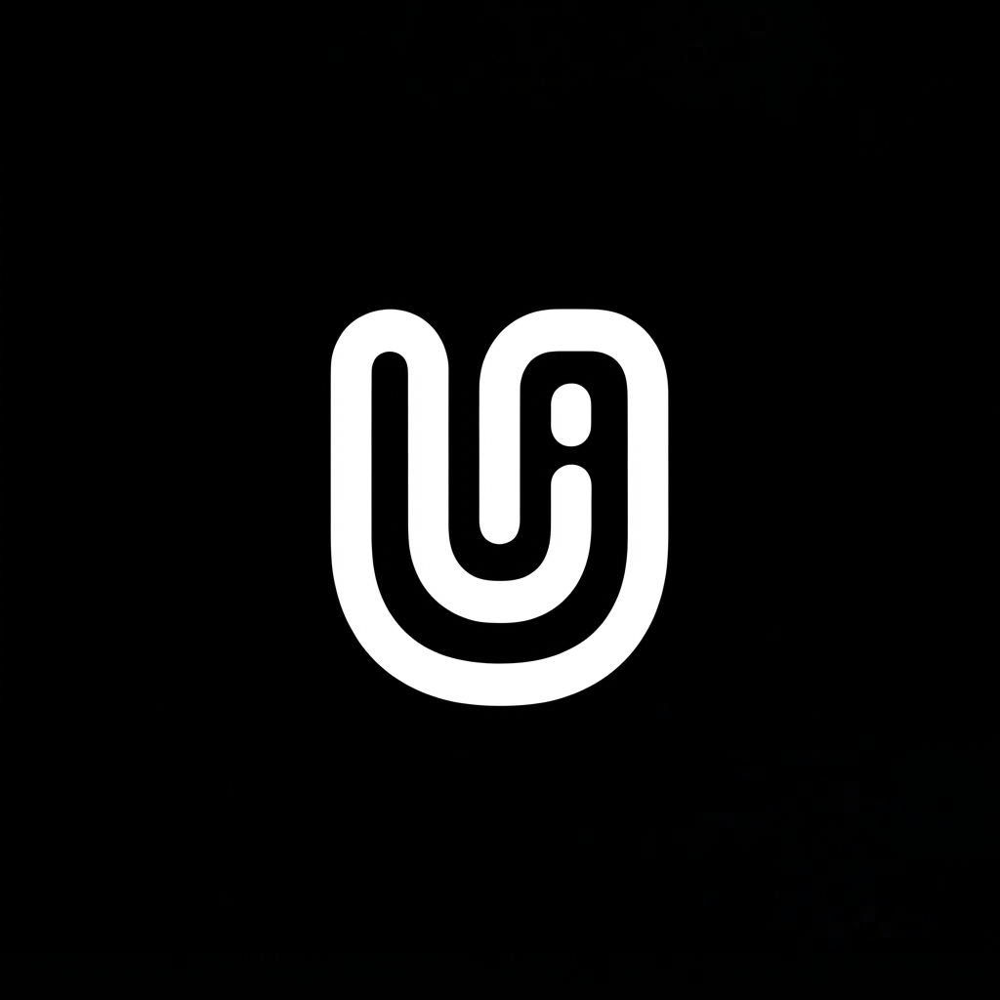

<div align="center">

# Uroo UI

**Monochromatic Liquid Glassmorphism — Design System & UI Toolkit**




**Pure HTML/CSS/JS design system — no build step, no Node runtime required.** Ship fully functional pages, layouts, SPA modules, and examples straight to the browser.

</div>

---

## ✨ Overview

Uroo UI is a monochromatic, liquid-glassmorphism design system and UI toolkit built with **Tailwind CSS v3**, **Lucide icons**, and plain modern **JavaScript**. Every page is a self-contained HTML file that runs directly in the browser — open it and it works.

It ships with a rich component library, **33 purpose-tuned layout pages**, **8 full SPA modules**, and a set of ready-to-use examples — all sharing a consistent premium brand shell (glass sidebar, theme persistence, floating controls).

## 🧱 What's inside

| Area | Path | Description |
|------|------|-------------|
| **Hub** | `index.html` | Design system hub / navigation root |
| **Pages** | `pages/` | 31 full reference pages (dashboard, settings, profile, auth, ecommerce, errors, utilities, landing) |
| **Layouts** | `layouts/` | 33 index + multi-page layout families (`app/`, `dashboard/`, `admin/`) — each page uses a layout matched to its actual purpose |
| **Modules** | `modules/` | 8 functional SPA apps (data analytics, CRM, ecommerce, finance, HR, inventory, notifications, project management) with hash-routed views |
| **Examples** | `examples/` | Composable showpieces (dashboard showcase, auth flow, ecommerce storefront, analytics, reports, team, projects, settings, FAQ) |
| **Components** | `components/` | Reusable UI building blocks |
| **Core** | `core/`, `fonts/`, `icons/`, `themes/`, `docs/` | Foundation layers, typography, icons, themes, documentation |

## 🎨 Design language

- **Monochromatic zinc palette** with restrained accent colors
- **Liquid glassmorphism** — frosted glass panels, soft glows, layered depth
- **Purpose-driven layouts** — settings pages are real forms, calendars are real calendars, funnels are real funnels (never one template stamped everywhere)
- **Theme persistence** via `localStorage['uroo-theme']` + OS `prefers-color-scheme`
- **No external CDN** — all assets vendored locally under `assets/`

## 🚀 Quick start

There is no build step. Serve the folder with any static server and open `index.html`:

```bash
# PHP
php -S localhost:8000

# Python
python3 -m http.server 8000

# Node
npx serve .
```

Then browse to `http://localhost:8000`.

### Add Uroo UI to a page

```html
<!-- Theme (must be FIRST in <head>) -->
<script src="assets/js/tailwind.js"></script>
<script>
  tailwind.config = {
    darkMode: 'class',
    theme: { extend: { colors: {
      glass: {
        light: 'rgba(255,255,255,0.65)',
        'light-border': 'rgba(255,255,255,0.8)',
        dark: 'rgba(18,18,20,0.65)',
        'dark-border': 'rgba(255,255,255,0.1)'
      }
    } } }
  };
</script>
<link rel="stylesheet" href="assets/css/uroo.css">
<script src="assets/js/lucide.js"></script>

<!-- Glass surface -->
<div class="glass-panel rounded-3xl p-6">Hello, Uroo UI 👋</div>

<!-- Lucide icons -->
<i data-lucide="sparkles" class="w-5 h-5"></i>
```

## 🗂️ Layouts that match their purpose

Every multi-page layout family builds each page around **what it actually does**:

- **Settings pages** → real settings UI: settings sidebar (Umum / Penagihan / Notifikasi / Tim), Workspace form, Lokalisasi selects, Tampilan appearance picker, save + toast
- **Calendar** → month grid + upcoming events
- **Inbox / notifications** → message lists with reading panes, feeds, preferences toggles
- **Team / members** → roster cards & management tables
- **Kanban / projects** → board columns and project cards with progress
- **Reports / budgets / payroll / invoices** → export centers, ledgers, and tables
- **FAQ / help** → searchable accordions + support cards

## 🧭 Module apps (SPA)

Each module is a single route hash-based SPA (`file.html#view`) with shared glass chrome. Stub entries (e.g. `analytics/pengaturan.html`) redirect into the parent app's view.

- **Analytics** — trends, segments, live stream, conversion funnel, retail, campaigns
- **CRM** — pipeline kanban, customers, interactions, targets, achievements
- **Ecommerce** — orders, products, customers, categories, vouchers, shipping, payments
- **Finance** — transactions, wallets, bills, budgets, savings, assets, tax
- **HR** — employees, leave, recruitment, payroll, reviews, org chart, attendance
- **Inventory** — stock, receipts, shipping, suppliers, warehouses, transfers
- **Notifications** — feeds, inbox, archive, preferences, channels, groups
- **Project Management** — projects, kanban, team, calendar, portfolio, templates, budgets

## 🖥️ GitHub Pages

This repository is published to GitHub Pages — you can browse the full design system and modules live in your browser.

## 📄 License

This project is open source. See the [LICENSE](LICENSE) file for details.

---

<div align="center">
  Built with <b>Uroo UI</b> · Monochromatic Liquid Glassmorphism
</div>
